<div align="center">

# cpu3d

**Agentic-first 3D modeling. Your AI agent builds the geometry, a tiny CPU rasterizer renders it.**

Connect Claude (or any agent) over MCP, ask for a scene, and watch it being built live in the editor.
The agent can *see* its own work: every `render_view` call returns a PNG rendered on the CPU, no GPU or browser required.

[](https://github.com/alparn/cpu3d/actions/workflows/ci.yml)
[](LICENSE)


[](https://modelcontextprotocol.io)

[Live demo](https://alparn.github.io/cpu3d/) · [Quick start](#quick-start) · [Connect an agent](#connect-an-agent) · [Tools](#tools) · [How it works](docs/how-it-works.md)

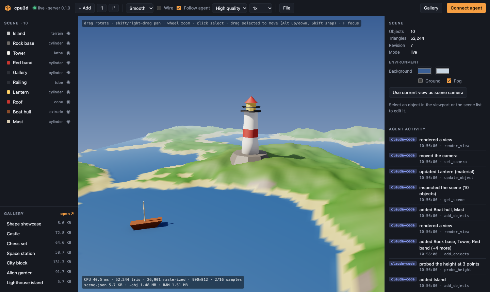

<sub>A scene built by Claude Code over MCP. The activity feed on the right shows every tool call as it happens.</sub>

</div>

## Why

Most 3D tools are built for hands on a mouse. cpu3d is built for agents first:

- **One API for everyone.** The editor has no private code paths. Every click calls the same tools an agent calls, so anything a human can do, an agent can do.
- **Agents get eyes.** `render_view` renders the scene headlessly on the CPU and returns an image. The agent builds, looks, and fixes, in a loop.
- **Geometry as JSON recipes.** Shapes are described declaratively (`lathe`, `sweep`, `extrude`, `tube`, `terrain`, ...). No code is evaluated, so recipes from any agent are safe, diffable and easy to edit by hand.
- **Zero dependencies.** Pure JavaScript, about 3,000 lines including the editor. The renderer is a real software rasterizer, not a WebGL wrapper.

## Gallery

Seven scenes ship with cpu3d. Open them from the **Gallery** in the editor, or start with `cpu3d serve --example castle`.
All of them are built in [`examples/build.mjs`](examples/build.mjs) through the same tool API an agent uses, including `probe_height` to put things on terrain.

<table>
<tr>
<td width="33%" valign="top">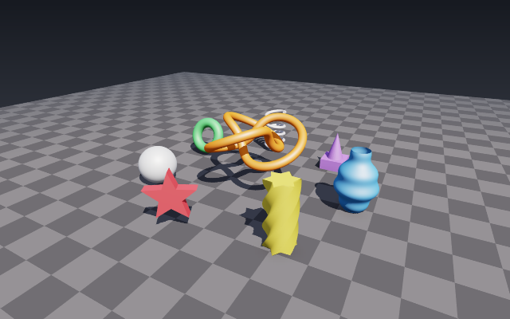<br><b>Shape showcase</b><br><sub>9 objects · 20,844 tris<br>recipes 6.0 KB · as .obj 615.2 KB</sub></td>
<td width="33%" valign="top">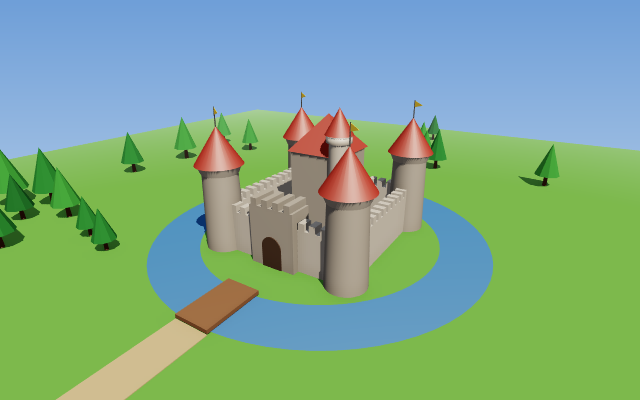<br><b>Castle</b><br><sub>156 objects · 4,703 tris<br>recipes 72.8 KB · as .obj 191.3 KB</sub></td>
<td width="33%" valign="top">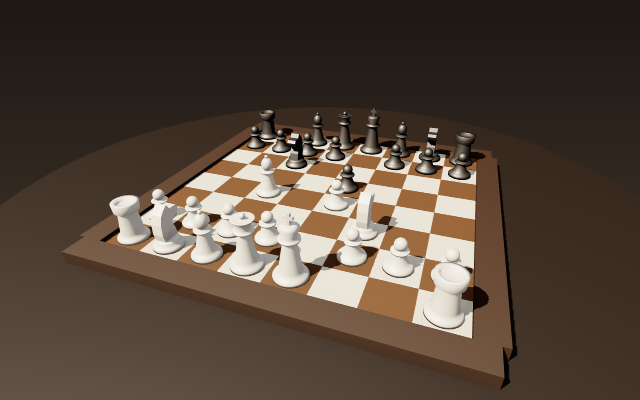<br><b>Chess set</b><br><sub>109 objects · 40,224 tris<br>recipes 64.6 KB · as .obj 1.20 MB</sub></td>
</tr>
<tr>
<td width="33%" valign="top">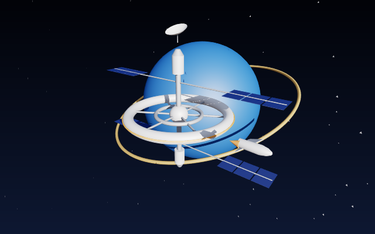<br><b>Space station</b><br><sub>37 objects · 18,876 tris<br>recipes 58.7 KB · as .obj 605.3 KB</sub></td>
<td width="33%" valign="top">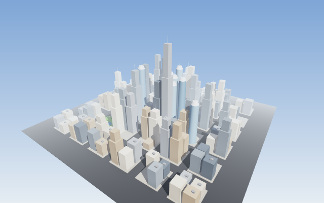<br><b>City block</b><br><sub>287 objects · 7,038 tris<br>recipes 131.3 KB · as .obj 335.8 KB</sub></td>
<td width="33%" valign="top">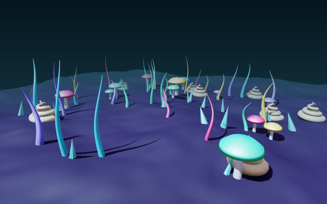<br><b>Alien garden</b><br><sub>83 objects · 73,316 tris<br>recipes 91.7 KB · as .obj 2.19 MB</sub></td>
</tr>
<tr>
<td width="33%" valign="top">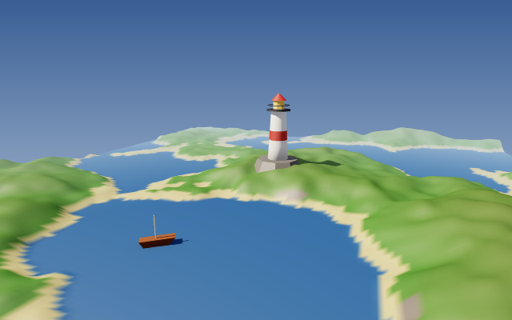<br><b>Lighthouse island</b><br><sub>10 objects · 52,244 tris<br>recipes 5.7 KB · as .obj 1.48 MB</sub></td>
</tr>
</table>

Recipes are compact: the lighthouse island is **5.7 KB** of JSON but **1.48 MB** once exported as triangles. The editor shows these numbers live for the scene and the selected object.

## Quick start

Requires Node.js 18 or newer.

```bash
npx -y github:alparn/cpu3d serve
```

Open **http://localhost:8173** (it starts with the shape showcase; `--example castle` or `--empty` change that), then connect your agent (next section) and ask something like:

> Build a small harbor: a wooden pier on posts, two boats, and a lighthouse on a rock. Check it with render_view from two angles and fix anything that floats or intersects.

Or clone it:

```bash
git clone https://github.com/alparn/cpu3d.git
cd cpu3d
npm start                    # editor + MCP on http://localhost:8173
npm run dev                  # same, autosaves to ./scene.json
```

## Connect an agent

The editor's **Connect agent** button shows these snippets with the right URL filled in.

**Claude Code**

```bash
claude mcp add --transport http cpu3d http://localhost:8173/mcp
```

**Claude Desktop** (`claude_desktop_config.json`, Settings → Developer → Edit Config)

```json
{
  "mcpServers": {
    "cpu3d": { "command": "npx", "args": ["-y", "github:alparn/cpu3d", "mcp"] }
  }
}
```

The stdio server starts the editor on port 8173 so you can watch. If an editor server is already running there, it forwards to it, so the agent edits the scene you have open.

**Cursor, VS Code, Windsurf and other MCP clients**

```json
{ "mcpServers": { "cpu3d": { "url": "http://localhost:8173/mcp" } } }
```

**Any agent framework (plain HTTP)**

```bash
curl http://localhost:8173/api/tools?format=openai          # tool schemas, OpenAI function format
curl -X POST http://localhost:8173/api/tools/add_objects \
  -H 'Content-Type: application/json' -H 'X-Cpu3d-Client: my-agent' \
  -d '{"objects":[{"name":"Ball","shape":{"type":"sphere","radius":0.5},"position":[0,0.5,0]}]}'
```

## Tools

| Tool | What it does |
|---|---|
| `get_shape_reference` | The recipe language: primitives, generative shapes, 2D shapes, paths, tips |
| `get_scene` | All objects with id, recipe, transform, material, triangle count and world bounds |
| `add_objects` | Add one or many objects in a single call |
| `update_object` | Change name, transform, material (merged) or replace the recipe |
| `remove_objects` / `clear_scene` | Delete objects |
| `load_scene` | Replace the whole scene with a scene document |
| `set_camera` | Set the scene camera, or `focus` on objects to frame them |
| `set_environment` | Background gradient, fog, light, ground grid |
| `probe_height` | Raycast down at `[x, z]` points: where is the surface? Place things on terrain or on other objects |
| `render_view` | **Render a PNG and return it to the agent**, with optional camera, focus, shading, wireframe, highlight |
| `export_obj` / `import_obj` | Wavefront OBJ out and in |
| `undo` / `redo` | Shared history for humans and agents |

The MCP server also sends a short guide in its `instructions`, so agents know the workflow (read reference → build → render → fix) without any prompt engineering on your side.

## Shape recipes

An object is plain JSON. Rotations are in degrees, colors are hex, Y is up and the ground is `y = 0`.

```json
{
  "name": "Vase",
  "shape": { "type": "lathe", "profile": [[0, 0], [0.4, 0], [0.5, 0.3], [0.3, 1.0], [0.35, 1.4]], "segments": 48 },
  "position": [0, 0, 0],
  "rotation": [0, 0, 0],
  "scale": 1,
  "material": { "color": "#4d99d9", "specular": 0.5, "doubleSided": true }
}
```

| Recipe | Idea |
|---|---|
| `box` `sphere` `cylinder` `cone` `torus` `plane` | Primitives |
| `lathe` | Revolve a 2D profile around Y (vases, towers, bottles, columns) |
| `extrude` | Push any 2D polygon (concave too) into depth, caps triangulated by ear clipping |
| `sweep` | Move a cross-section along a 3D path, with twist and taper (rails, frames, twisted columns, horns) |
| `tube` | Sweep of a circle (pipes, cables, springs, handles, knots) |
| `terrain` | Noise heightfield with water level and height-based colors |
| `mesh` | Raw triangles |

2D shapes (`circle`, `polygon`, `rect`, `star` or point lists) and paths (`line`, `circle`, `helix`, `torusKnot` or point lists) plug into `extrude`, `sweep` and `tube`. The full reference is what `get_shape_reference` returns, see [`src/recipes.js`](src/recipes.js).

## The editor

- Live sync over Server-Sent Events: agent changes appear instantly, with an **activity feed** that attributes each step to its agent (`claude-code`, `cursor`, `you`, ...)
- **Follow agent**: the viewport jumps to whatever the agent is looking at with `render_view`
- Click to select (CPU ray picking), then **drag the selected object with the mouse** to move it on the ground; hold **Alt** to move it up/down, **Shift** to snap to a 0.25 m grid. Each drag is one `update_object` call, so it is undoable and visible to agents
- Outliner, inspector (transform, material, editable JSON recipe), undo/redo
- Gallery of example scenes; add menu with presets; OBJ and scene JSON import/export
- Size readouts: what the scene weighs as `scene.json` and as `.obj`, geometry RAM, and the same for the selected object; load and download times and sizes are reported too
- **High quality** rendering with shadows and ambient occlusion that refines itself when the view is still, or **Fast** mode
- Orbit / pan / zoom, smooth, flat and normal shading, wireframe, resolution scaling
- **Local mode**: without a server (for example on GitHub Pages) the same tools run in the browser

Mouse: drag rotate · shift/right-drag pan · wheel zoom · click select · drag selected object to move (Alt up/down, Shift snap)

Keyboard: `F` focus · `W` wireframe · `Del` delete · `Ctrl/Cmd+Z` undo · `Shift+Ctrl/Cmd+Z` redo · `Ctrl/Cmd+D` duplicate · `Esc` cancel move / deselect

## Rendering on the CPU

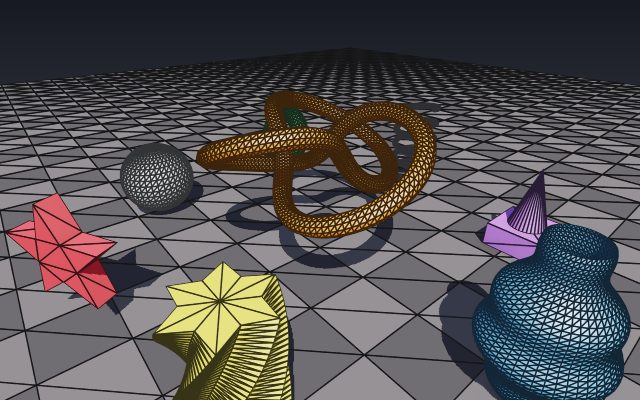 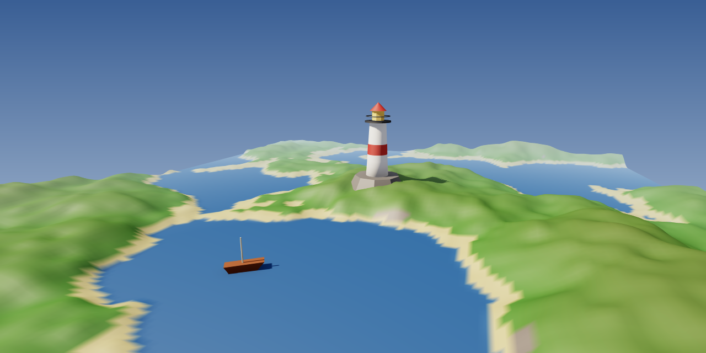

Both images were rendered by the CLI, for example `cpu3d render examples/lighthouse.json out.png`.

The pipeline is the same one a GPU runs, written out in JavaScript:

1. **Mesh culling** with bounding spheres against the six frustum planes
2. **Vertex stage**: model-view-projection, outcodes, projection onto a 1/16 sub-pixel grid
3. **Primitive stage**: trivial reject, homogeneous Sutherland-Hodgman clipping only against near/far and a guard band, back-face culling by signed area
4. **Rasterization**: half-space edge functions in exact integer math with the top-left fill rule, **per-row spans solved analytically** (no per-pixel inside tests), attributes as plane equations (one add per pixel), 1/w depth buffer

### Two quality modes

| | **High** (default) | **Fast** |
|---|---|---|
| Lighting | per pixel (deferred G-buffer), linear color space | per vertex (Gouraud) |
| Shadows | directional shadow map, soft PCF edges, cached per scene | none |
| Ambient occlusion | screen-space AO, half resolution, depth-aware blur | none |
| Tone mapping | ACES filmic + sRGB | ACES filmic + sRGB |
| Anti-aliasing | progressive: jittered frames are averaged while the view is still | none |

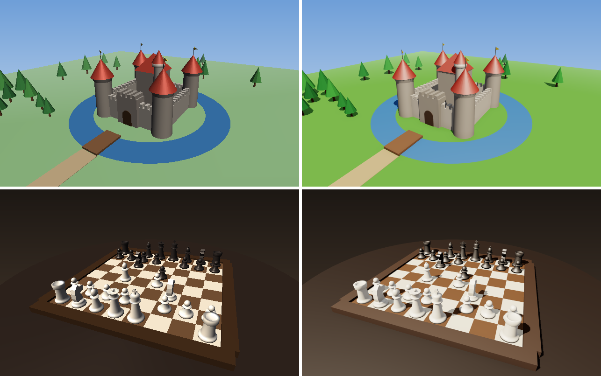

<sub>Left: the first release (fast mode). Right: high quality. Same scenes, same recipes.</sub>

The editor refines the image up to 16 samples when the camera stops; `render_view` returns 8-sample renders to agents.

| Scene (1280×720, one core, Node 23, Apple Silicon) | Triangles | Fast | High (1 sample) |
|---|---:|---:|---:|
| Showcase | 23k | 3.3 ms | 27 ms |
| Terrain | 97k | 7.5 ms | 38 ms |
| Stress test (36 torus knots) | 224k | 16.5 ms | 39 ms |

The fast path pushes about 12 million triangles and up to 280 million pixels per second on a single thread. Coverage is verified pixel-exact against a brute-force reference in the test suite. Run `npm run bench` or open [`demo/`](demo/index.html) for the interactive benchmark; the details are in [docs/how-it-works.md](docs/how-it-works.md).

## Use it as a library

```js
import { Renderer, Camera, Mesh, tube, paths, sweep, shapes } from 'cpu3d';

const renderer = new Renderer({ canvas: document.querySelector('canvas') }); // or { width, height } in Node
const knot = tube(paths.torusKnot(2, 3, 256, 1.5), 0.14, 12, { closed: true });
const column = sweep(shapes.star(6, 0.45, 0.28), paths.line([0, 0, 0], [0, 2, 0], 60), { twist: Math.PI });

const scene = { meshes: [new Mesh(knot, { color: [1, 0.55, 0.2] }), new Mesh(column, { position: [3, 0, 0] })] };
const camera = new Camera({ position: [0, 3, 8] });

renderer.quality = 'high';                                   // or 'fast'
renderer.render(scene, camera);                              // first sample
for (let i = 0; i < 7; i++) renderer.render(scene, camera, { accumulate: true }); // refine
// Node: renderer.pixels is an RGBA Uint8ClampedArray
```

## Project layout

```
bin/cpu3d.js        CLI: serve, mcp (stdio), render
server/             HTTP server (editor, SSE, REST, MCP Streamable HTTP), MCP protocol, PNG encoder
src/renderer.js     the software rasterizer
src/geometry.js     geometry builder: rims, lathe, sweep, extrude, ear clipping, OBJ
src/recipes.js      JSON recipes -> geometry, validation, agent reference
src/document.js     scene document, validation, undo/redo
src/tools.js        the tool API used by agents and the editor
src/scene.js        document -> renderable scene, camera, ray picking
editor/             the editor UI (vanilla JS, no build step)
demo/               interactive renderer benchmark
examples/           gallery scenes, thumbnails and build.mjs that creates them
test/               node:test suite
```

## Security

The server binds to `127.0.0.1` and rejects requests whose `Host` or `Origin` is not localhost, which protects against DNS rebinding. Recipes are data, never code. See [SECURITY.md](SECURITY.md).

## Roadmap

- Multi-threaded tile renderer (Web Workers / worker_threads)
- Materials: metalness with sky reflections, Fresnel rim, emissive surfaces
- Bevels for box and extrude, crease angle for smoothing groups
- Groups and hierarchy, boolean operations (CSG)
- Textures with perspective-correct UVs
- glTF export
- MCP resources for scenes and live notifications

Ideas and pull requests are welcome, see [CONTRIBUTING.md](CONTRIBUTING.md).

## License

[MIT](LICENSE). Inspired by the procedural approach of the old Babylon.js *GeometryBuilder* extension.
