<div align="center">

# cpu3d

**Agentic-first 3D modeling. Your AI agent builds the geometry, a tiny CPU rasterizer renders it.**

Connect Claude (or any agent) over MCP, ask for a scene, and watch it being built live in the editor.
The agent can *see* its own work: every `render_view` call returns a PNG rendered on the CPU, no GPU or browser required.

[](https://github.com/alparn/cpu3d/actions/workflows/ci.yml)
[](LICENSE)


[](https://modelcontextprotocol.io)

[Live demo](https://alparn.github.io/cpu3d/) · [Quick start](#quick-start) · [Connect an agent](#connect-an-agent) · [Tools](#tools) · [How it works](docs/how-it-works.md)


<sub>A scene built by Claude Code over MCP. The activity feed on the right shows every tool call as it happens.</sub>

</div>

## Why

Most 3D tools are built for hands on a mouse. cpu3d is built for agents first:

- **One API for everyone.** The editor has no private code paths. Every click calls the same tools an agent calls, so anything a human can do, an agent can do.
- **Agents get eyes.** `render_view` renders the scene headlessly on the CPU and returns an image. The agent builds, looks, and fixes, in a loop.
- **Geometry as JSON recipes.** Shapes are described declaratively (`lathe`, `sweep`, `extrude`, `tube`, `terrain`, ...). No code is evaluated, so recipes from any agent are safe, diffable and easy to edit by hand.
- **Zero dependencies.** Pure JavaScript, about 3,000 lines including the editor. The renderer is a real software rasterizer, not a WebGL wrapper.

## Gallery

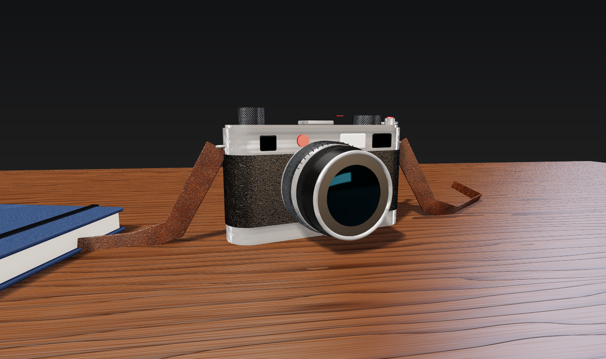

<sub>Photographer's desk: a vintage rangefinder at real scale on oiled walnut. Pebbled leather, satin chrome, knurled dials, the walnut grain, the cloth of the notebook and the marble of the coaster are all procedural <code>pattern</code>s with relief, evaluated per pixel in object space on any shape. 49 objects, 34 KB of JSON, no image files.</sub>

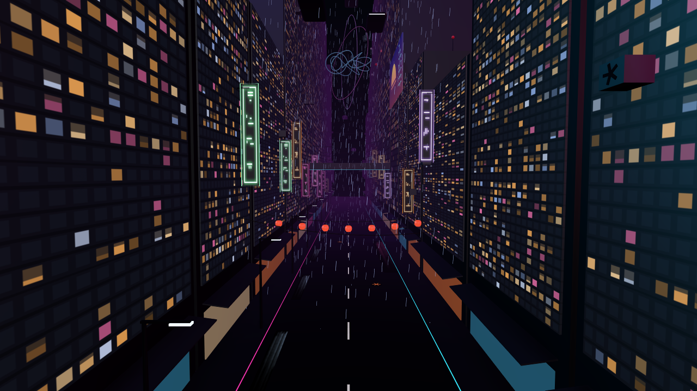

<p align="center">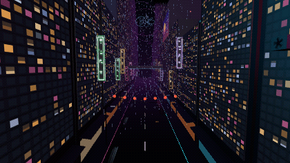</p>

<sub>Neon district: 462 objects, everything procedural. Towers carry painted window textures (thousands of lit windows from three PNGs made by the build script), neon signs with abstract glyphs flicker and smear their light across the wet asphalt, rain is one raw mesh of 1,800 streaks falling in two stacked layers so the loop is seamless, flying cars cruise in four lanes, an elevated train crosses, lanterns swing and a hologram turns in the purple haze.</sub>

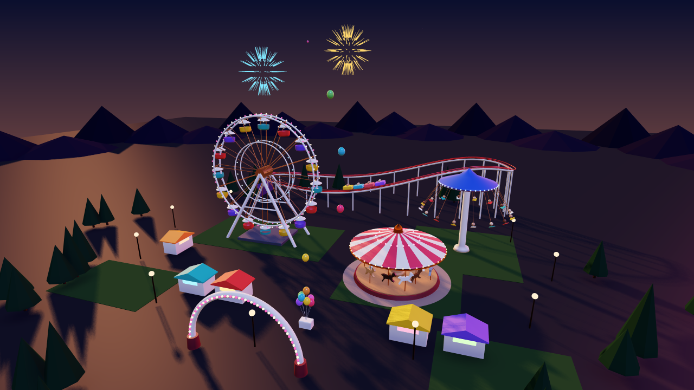

<p align="center">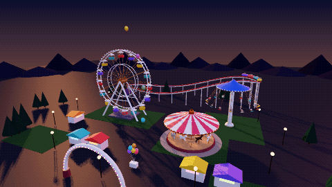 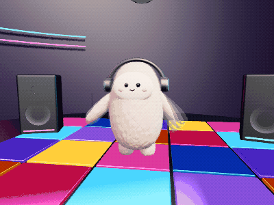</p>

<sub>Fairground at dusk: 339 objects, 98,046 triangles, everything moving. The Ferris wheel gondolas orbit and counter-rotate so they hang upright, horses gallop on the carousel, chairs fly out on the wave swinger, the roller coaster train follows its track on spline keyframes timed by energy conservation (slow over the lift hill, fast in the dips), fireworks burst with keyframed scale and glow, balloons drift away with <code>flow</code>. Built in about 240 lines of <a href="examples/build.mjs">examples/build.mjs</a>.</sub>

<sub>Plush dancer (right): a fluffy character whose fur is surface <code>noise</code>, dancing to a 120 bpm beat. cpu3d has no object hierarchy, so the build script poses a small skeleton (root bounce, sway and twist; shoulders and hips) and bakes it into keyframes for each of the 59 parts; a slow <code>orbit</code> turns the whole dancer.</sub>

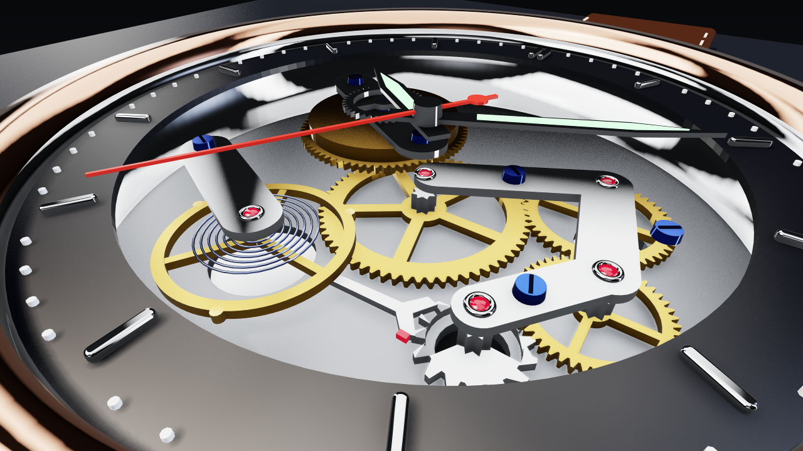

<sub>The skeleton watch scene: 170 parts, every one a JSON recipe (spoked gears are extrudes with holes, the hairspring is a tube along a spiral), rendered on one CPU core. Full view: [docs/watch.png](docs/watch.png).</sub>


<sub>Turbofan cutaway: about 1,350 NACA-profiled blades in radial arrays and casings revolved through 240°. 47 KB of recipes, 4.15 MB once exported as triangles.</sub>

Fourteen scenes ship with cpu3d, all of them animated. Open them from the **Gallery** in the editor, or start with `cpu3d serve --example castle`.
All of them are built in [`examples/build.mjs`](examples/build.mjs) through the same tool API an agent uses, including `probe_height` to put things on terrain.

<table>
<tr>
<td width="33%" valign="top"><br><b>Shape showcase</b><br><sub>9 objects · 20,844 tris<br>recipes 7.5 KB · as .obj 615.2 KB</sub></td>
<td width="33%" valign="top">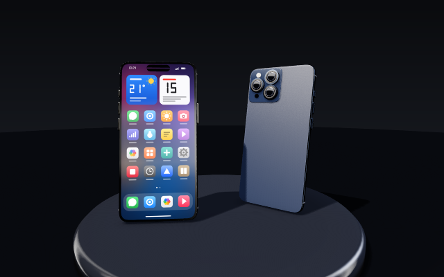<br><b>Smartphone</b><br><sub>65 objects · 25,188 tris<br>recipes 46.3 KB · as .obj 840.1 KB</sub></td>
<td width="33%" valign="top">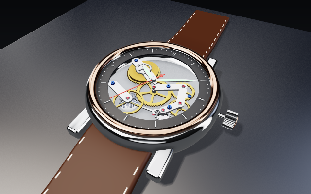<br><b>Skeleton watch</b><br><sub>170 objects · 32,758 tris<br>recipes 172.0 KB · as .obj 1.25 MB</sub></td>
</tr>
<tr>
<td width="33%" valign="top">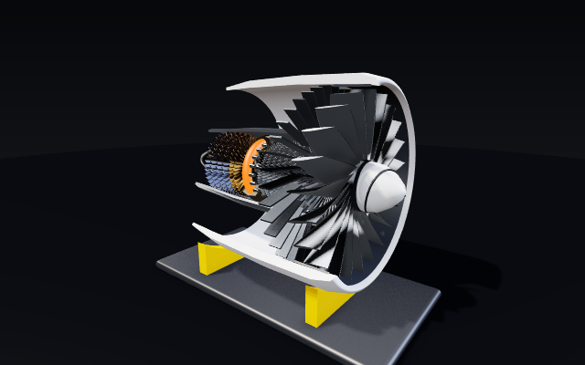<br><b>Turbofan cutaway</b><br><sub>69 objects · 143,338 tris<br>recipes 74.2 KB · as .obj 5.16 MB</sub></td>
<td width="33%" valign="top">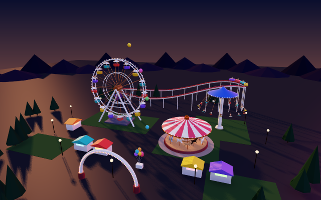<br><b>Fairground at dusk</b><br><sub>339 objects · 98,046 tris<br>recipes 409.2 KB · as .obj 3.37 MB</sub></td>
<td width="33%" valign="top">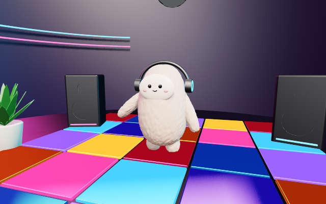<br><b>Plush dancer</b><br><sub>62 objects · 76,990 tris<br>recipes 270.8 KB · as .obj 2.43 MB</sub></td>
</tr>
<tr>
<td width="33%" valign="top">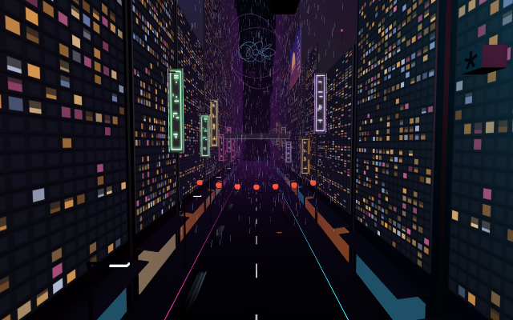<br><b>Neon district</b><br><sub>462 objects · 29,082 tris<br>recipes 534.9 KB · as .obj 1.26 MB</sub></td>
<td width="33%" valign="top">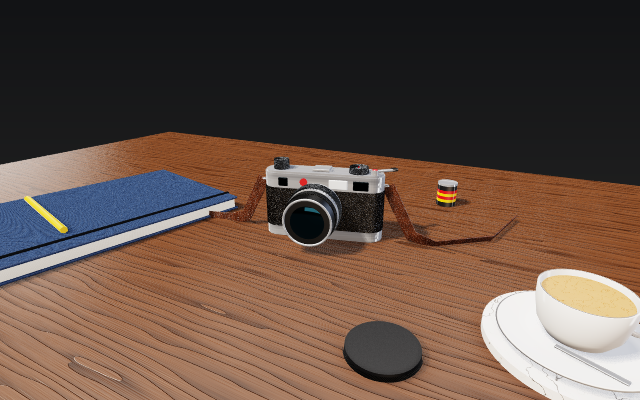<br><b>Photographer's desk</b><br><sub>49 objects · 28,308 tris<br>recipes 34.0 KB · as .obj 946.6 KB</sub></td>
<td width="33%" valign="top"><br><b>Castle</b><br><sub>156 objects · 4,703 tris<br>recipes 77.4 KB · as .obj 191.3 KB</sub></td>
</tr>
<tr>
<td width="33%" valign="top"><br><b>Chess set</b><br><sub>109 objects · 40,224 tris<br>recipes 84.9 KB · as .obj 1.20 MB</sub></td>
<td width="33%" valign="top"><br><b>Space station</b><br><sub>37 objects · 18,876 tris<br>recipes 63.5 KB · as .obj 605.3 KB</sub></td>
<td width="33%" valign="top"><br><b>City block</b><br><sub>319 objects · 17,694 tris<br>recipes 166.0 KB · as .obj 683.1 KB</sub></td>
</tr>
<tr>
<td width="33%" valign="top"><br><b>Alien garden</b><br><sub>83 objects · 73,316 tris<br>recipes 108.5 KB · as .obj 2.19 MB</sub></td>
<td width="33%" valign="top"><br><b>Lighthouse island</b><br><sub>11 objects · 52,246 tris<br>recipes 7.5 KB · as .obj 1.48 MB</sub></td>
</tr>
</table>

Recipes are compact: the lighthouse island is **7.5 KB** of JSON but **1.48 MB** once exported as triangles. The editor shows these numbers live for the scene and the selected object.

## Quick start

Requires Node.js 18 or newer.

```bash
npx -y github:alparn/cpu3d serve
```

Open **http://localhost:8173** (it starts with the shape showcase; `--example castle` or `--empty` change that), then connect your agent (next section) and ask something like:

> Build a small harbor: a wooden pier on posts, two boats, and a lighthouse on a rock. Check it with render_view from two angles and fix anything that floats or intersects.

Or clone it:

```bash
git clone https://github.com/alparn/cpu3d.git
cd cpu3d
npm start                    # editor + MCP on http://localhost:8173
npm run dev                  # same, autosaves to ./scene.json
```

## Connect an agent

The editor's **Connect agent** button shows these snippets with the right URL filled in.

**Claude Code**

```bash
claude mcp add --transport http cpu3d http://localhost:8173/mcp
```

**Claude Desktop** (`claude_desktop_config.json`, Settings → Developer → Edit Config)

```json
{
  "mcpServers": {
    "cpu3d": { "command": "npx", "args": ["-y", "github:alparn/cpu3d", "mcp"] }
  }
}
```

The stdio server starts the editor on port 8173 so you can watch. If an editor server is already running there, it forwards to it, so the agent edits the scene you have open.

**Cursor, VS Code, Windsurf and other MCP clients**

```json
{ "mcpServers": { "cpu3d": { "url": "http://localhost:8173/mcp" } } }
```

**Any agent framework (plain HTTP)**

```bash
curl http://localhost:8173/api/tools?format=openai          # tool schemas, OpenAI function format
curl -X POST http://localhost:8173/api/tools/add_objects \
  -H 'Content-Type: application/json' -H 'X-Cpu3d-Client: my-agent' \
  -d '{"objects":[{"name":"Ball","shape":{"type":"sphere","radius":0.5},"position":[0,0.5,0]}]}'
```

## Tools

| Tool | What it does |
|---|---|
| `get_shape_reference` | The recipe language: primitives, generative shapes, 2D shapes, paths, tips |
| `get_scene` | All objects with id, recipe, transform, material, triangle count and world bounds |
| `add_objects` | Add one or many objects in a single call |
| `update_object` | Change name, transform, material (merged) or replace the recipe |
| `remove_objects` / `clear_scene` | Delete objects |
| `load_scene` | Replace the whole scene with a scene document |
| `set_camera` | Set the scene camera, or `focus` on objects to frame them |
| `set_environment` | Background gradient, fog, light, ground grid |
| `set_animation` | Make objects move: behaviours (`spin`, `swing`, `bob`, `orbit`, `pulse`), keyframes, a camera path, the timeline length |
| `set_keyframe` | Add, merge or delete one keyframe of an object or of the camera path |
| `render_animation` | **One image with several frames of the animation**, so the agent sees the motion at a glance |
| `export_gif` | Render an animated GIF with motion blur (saved to `exports/`, downloaded in the browser editor) |
| `probe_height` | Raycast down at `[x, z]` points: where is the surface? Place things on terrain or on other objects |
| `render_view` | **Render a PNG and return it to the agent**, with optional camera, focus, shading, wireframe, highlight and animation `time` |
| `export_obj` / `import_obj` | Wavefront OBJ out and in |
| `undo` / `redo` | Shared history for humans and agents |

The MCP server also sends a short guide in its `instructions`, so agents know the workflow (read reference → build → render → fix) without any prompt engineering on your side.

## Shape recipes

An object is plain JSON. Rotations are in degrees, colors are hex, Y is up and the ground is `y = 0`.

```json
{
  "name": "Vase",
  "shape": { "type": "lathe", "profile": [[0, 0], [0.4, 0], [0.5, 0.3], [0.3, 1.0], [0.35, 1.4]], "segments": 48 },
  "position": [0, 0, 0],
  "rotation": [0, 0, 0],
  "scale": 1,
  "material": { "color": "#4d99d9", "specular": 0.5, "doubleSided": true }
}
```

| Recipe | Idea |
|---|---|
| `box` `sphere` `cylinder` `cone` `torus` `plane` | Primitives |
| `roundedBox` | Box with smooth rounded edges and corners (devices, furniture, buttons) |
| `lathe` | Revolve a 2D profile around Y (vases, towers, bottles, columns); partial revolutions for cutaways |
| `radial` | Repeat any shape around an axis (blade rings, spokes, columns), one object for hundreds of copies |
| `extrude` | Push any 2D polygon (concave too, with `holes`) into depth, caps triangulated by ear clipping |
| `sweep` | Move a cross-section along a 3D path, with twist and taper (rails, frames, twisted columns, horns) |
| `tube` | Sweep of a circle (pipes, cables, springs, handles, knots) |
| `terrain` | Noise heightfield with water level and height-based colors |
| `mesh` | Raw triangles |
| `noise` on any recipe | Displace the surface along its normals by fractal noise: fur and plush, rocks, bark, clay |

2D shapes (`circle`, `polygon`, `rect`, `roundedRect` with optional squircle corners, `star` or point lists) and paths (`line`, `circle`, `helix`, `torusKnot` or point lists) plug into `extrude`, `sweep` and `tube`. The full reference is what `get_shape_reference` returns, see [`src/recipes.js`](src/recipes.js).

### Materials and light

```json
"material": { "color": "#b9b6b0", "metalness": 1, "roughness": 0.25 }                       // polished titanium
"material": { "color": "#ffffff", "texture": "examples/textures/screen.png", "emissive": 1 }  // a lit display
```

| Property | Meaning |
|---|---|
| `color`, `specular`, `shininess` | base color and the sun highlight |
| `metalness` 0..1 | metals reflect in their own color and have no diffuse light |
| `roughness` 0..1 | 0 = mirror, 1 = matte (default 0.7); sharp or blurry reflections |
| `emissive` 0..10 | self-illumination; `1` shows the color or texture exactly as authored |
| `texture` | PNG in the project or a `data:image/png;base64` URL; `mapping` `planar` (default, thinnest axis), `box` (from all sides), `cylinder` (labels), `sphere`, and `repeat` to tile it |
| `pattern` | Procedural surface with relief, no image: `wood`, `marble`, `leather`, `carbon`, `fabric`, `brushed`, `checker`, `stripes`, `knurl`, with 2-3 `colors`, `scale` and `bump` |
| `flat`, `doubleSided` | faceted shading, open surfaces |

`set_environment` controls what glossy surfaces reflect (`reflections: "sky" | "studio" | "none"`), the main light (`intensity`, `softness` for soft shadows) and up to four extra `lights` for fill and rim lighting.

### Animation

<p align="center">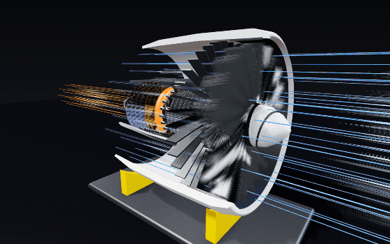</p>

Objects move with declarative behaviours, keyframes, or both, so an agent can animate a whole machine in a few calls. Everything is evaluated per frame. Geometry is never rebuilt, only the object matrix and the glow change.

| Behaviour | Parameters | Good for |
|---|---|---|
| `spin` | `axis`, `speed` (deg/s), `step` (s, ticking), `pivot` | rotors, wheels, clock hands |
| `swing` | `axis`, `amplitude` (deg), `period`, `phase`, `pivot` | pendulums, balance wheels, doors |
| `bob` | world `axis`, `amplitude`, `period`, `phase` | floating boats, hovering drones |
| `orbit` | `center`, `axis`, `speed` | turntables, planets, satellites |
| `pulse` | `min`, `max`, `period`, `phase`, `blink` | breathing lights, warning beacons |
| `flow` | world `axis`, `distance`, `speed`, `phase`, `fade` | wind streaks, particles, exhaust, conveyor belts |

```json
{ "id": "obj_7", "animation": { "spin": { "axis": [0, 0, 1], "speed": -6, "step": 1, "pivot": [0, 0.4, 0] } } }
```

Without `pivot`, spin and swing turn around the object's own origin and local axis; with `pivot`, around a world axis through that point, so several parts can turn as one. The timeline loops after `duration` seconds (default 12).

**Keyframes** replace the base transform over time; behaviours are applied on top. Each channel (`position`, `rotation`, `scale`, `emissive`) is interpolated between the keys that define it, with `ease` set to `smooth` (eases in and out at each key), `linear`, `spline` (a smooth curve through all keys, good for flight paths) or `step`:

```json
{ "id": "obj_3", "animation": { "ease": "spline", "keys": [
  { "t": 0, "position": [0, 2, 0] }, { "t": 3, "position": [4, 3, 1], "rotation": [0, 90, 0] }, { "t": 6, "position": [0, 2, 0] } ] } }
```

A **camera path** works the same way for `yaw`, `pitch`, `distance` and `target`: `set_animation({ camera: { keys: [{ "t": 0, "yaw": 0 }, { "t": 12, "yaw": 360 }], ease: "linear" } })` is a turntable. `set_keyframe` adds one key at a time, for objects or for `"camera"`.

Agents check the motion with `render_animation` (one contact sheet with several frames) or `render_view({ time: 2.5 })`. The CLI renders stills and GIFs:

```bash
cpu3d render examples/watch.json still.png --time 2.5
cpu3d gif examples/city.json city.gif --width 480 --height 300 --fps 15 --seconds 6
```

GIFs are rendered in high quality with **motion blur** (each frame averages several samples spread over the shutter time), one stable palette for the whole clip and delta frames, so a mostly static shot stays small. Every gallery scene is animated: the watch ticks under a slow camera move, the turbofan spins, the station rotates, a blimp flies a keyframed spline loop around the city while the beacons blink, and the lighthouse lantern pulses while a boat rocks on the sea.

## The editor

- Live sync over Server-Sent Events: agent changes appear instantly, with an **activity feed** that attributes each step to its agent (`claude-code`, `cursor`, `you`, ...)
- **Follow agent**: the viewport jumps to whatever the agent is looking at with `render_view`
- Click to select (CPU ray picking), then **drag the selected object with the mouse** to move it on the ground; hold **Alt** to move it up/down, **Shift** to snap to a 0.25 m grid. Each drag is one `update_object` call, so it is undoable and visible to agents
- Outliner, inspector (transform, material, editable JSON recipe), undo/redo
- **New scene** (File menu, `Shift+N`, or the top of the gallery): an empty stage with ground grid, or a ready photo studio with podium and softboxes
- **Timeline**: animated scenes play automatically; play/pause and scrub at the bottom of the viewport, with diamonds for the keys of the selected object (or of the camera path)
- **Keyframing**: `◆` or `K` records the selected object's pose at the current time (with nothing selected: the view as a camera path key). Once an object has keys, moving it or editing its transform sets a key at the current time. `🎥` toggles following the camera path; orbiting the view leaves it
- The inspector has animation presets (spin, swing, bob, pulse) and a JSON field for behaviours and keys
- **Effects** button (`E`): shows or hides everything marked as an effect (`"effect": true` on an object: airflow, rain, fireworks); a view setting, the scene stays unchanged. `render_view({ effects: false })` does the same for agents
- **Export animated GIF** (File menu): rendered in the browser with motion blur, with size, frame rate, clip and camera options
- Gallery of example scenes; add menu with presets; OBJ and scene JSON import/export
- Size readouts: what the scene weighs as `scene.json` and as `.obj`, geometry RAM, and the same for the selected object; load and download times and sizes are reported too
- **High quality** rendering with shadows and ambient occlusion that refines itself when the view is still, or **Fast** mode
- Orbit / pan / zoom, smooth, flat and normal shading, wireframe, resolution: Auto (full Retina resolution when still), 0.5×, 1×, Retina
- **Local mode**: without a server (for example on GitHub Pages) the same tools run in the browser

Mouse: drag rotate · shift/right-drag pan · wheel zoom · click select · drag selected object to move (Alt up/down, Shift snap)

Keyboard: `Space` play/pause · `K` keyframe · `E` effects on/off · `Shift+N` new scene · `F` focus · `W` wireframe · `Del` delete · `Ctrl/Cmd+Z` undo · `Shift+Ctrl/Cmd+Z` redo · `Ctrl/Cmd+D` duplicate · `Esc` cancel move / deselect

## Rendering on the CPU

 

Both images were rendered by the CLI, for example `cpu3d render examples/lighthouse.json out.png`.

The pipeline is the same one a GPU runs, written out in JavaScript:

1. **Mesh culling** with bounding spheres against the six frustum planes
2. **Vertex stage**: model-view-projection, outcodes, projection onto a 1/16 sub-pixel grid
3. **Primitive stage**: trivial reject, homogeneous Sutherland-Hodgman clipping only against near/far and a guard band, back-face culling by signed area
4. **Rasterization**: half-space edge functions in exact integer math with the top-left fill rule, **per-row spans solved analytically** (no per-pixel inside tests), attributes as plane equations (one add per pixel), 1/w depth buffer

### Two quality modes

| | **High** (default) | **Fast** |
|---|---|---|
| Lighting | per pixel (deferred G-buffer), linear color space, extra fill/rim lights | per vertex (Gouraud) |
| Materials | metalness, roughness, Fresnel reflections of a sky or studio environment, textures | color only |
| Shadows | directional shadow map, adjustable soft edges, cached per scene | none |
| Ambient occlusion | screen-space AO, half resolution, depth-aware blur | none |
| Tone mapping | ACES filmic + sRGB | ACES filmic + sRGB |
| Anti-aliasing | temporal (TAA) while things move, progressive averaging of jittered frames when the view is still | none |
| Threads | lighting, AO and anti-aliasing on all cores (Web Workers / worker_threads, shared memory) | one |


<sub>Left: the first release (fast mode). Right: high quality. Same scenes, same recipes.</sub>

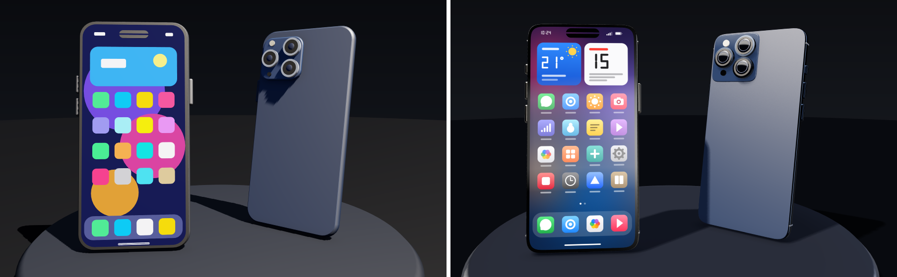

<sub>The Smartphone scene before and after metal and glass materials, studio softbox reflections, a textured display, squircle bodies and camera details. Close-up of the camera module: [docs/phone-camera.png](docs/phone-camera.png).</sub>

### Multi-threaded, temporal, adaptive

- **All cores**: the main thread rasterizes the G-buffer, a pool of workers does the per-pixel work (AO, blur, lighting, anti-aliasing) in row chunks over `SharedArrayBuffer`s. The result is pixel-identical to one thread. The cpu3d server sends the cross-origin isolation headers this needs; on GitHub Pages a tiny service worker (`coi-sw.js`) adds them. Without isolation the editor falls back to one thread.
- **Temporal anti-aliasing** while orbiting, zooming or playing an animation: every frame is jittered, the previous result is reprojected with motion vectors (Catmull-Rom sampling), clipped to the variance of the current neighbourhood and blended in: as a running average while a pixel stays put (no flicker), faster when it moves. Animated objects bring their own motion vectors. Edges, AO and soft shadows stay smooth in motion instead of shimmering.
- **Seamless refinement**: when the view stops, the progressive 16-sample average starts from the temporal history, so there is no drop in quality.
- **Adaptive resolution**: if a full frame would take longer than about 34 ms, motion is rendered at a reduced resolution (down to 40%) and scaled up; the still image is always full resolution.
- **Shadow cache**: static objects go into a cached shadow map shared by all renderers; during an animation only the moving objects are drawn again.

| Turbofan, 900×852 in the editor (Apple Silicon, 8 worker threads) | Before | Now |
|---|---:|---:|
| Frame while orbiting or playing (with TAA) | ~110 ms | 24 ms |
| GIF export, 45 frames × 6 samples, 560×350 | 12.7 s | 5.7 s |

The editor refines the image up to 16 samples when the camera stops; `render_view` returns 8-sample renders to agents.

| Scene (1280×720, one core, Node 23, Apple Silicon) | Triangles | Fast | High (1 sample) |
|---|---:|---:|---:|
| Showcase | 23k | 3.3 ms | 33 ms |
| Terrain | 97k | 7.5 ms | 45 ms |
| Stress test (36 torus knots) | 224k | 16.5 ms | 47 ms |

The fast path pushes about 12 million triangles and up to 280 million pixels per second on a single thread. Coverage is verified pixel-exact against a brute-force reference in the test suite. Run `npm run bench` or open [`demo/`](demo/index.html) for the interactive benchmark; the details are in [docs/how-it-works.md](docs/how-it-works.md).

## Use it as a library

```js
import { Renderer, Camera, Mesh, tube, paths, sweep, shapes } from 'cpu3d';

const renderer = new Renderer({ canvas: document.querySelector('canvas') }); // or { width, height } in Node
const knot = tube(paths.torusKnot(2, 3, 256, 1.5), 0.14, 12, { closed: true });
const column = sweep(shapes.star(6, 0.45, 0.28), paths.line([0, 0, 0], [0, 2, 0], 60), { twist: Math.PI });

const scene = { meshes: [new Mesh(knot, { color: [1, 0.55, 0.2] }), new Mesh(column, { position: [3, 0, 0] })] };
const camera = new Camera({ position: [0, 3, 8] });

renderer.quality = 'high';                                   // or 'fast'
renderer.render(scene, camera);                              // first sample
for (let i = 0; i < 7; i++) renderer.render(scene, camera, { accumulate: true }); // refine
// Node: renderer.pixels is an RGBA Uint8ClampedArray
```

## Project layout

```
bin/cpu3d.js        CLI: serve, mcp (stdio), render
server/             HTTP server (editor, SSE, REST, MCP Streamable HTTP), MCP protocol, PNG encoder
src/renderer.js     the software rasterizer
src/geometry.js     geometry builder: rims, lathe, sweep, extrude, ear clipping, OBJ
src/recipes.js      JSON recipes -> geometry, validation, agent reference
src/document.js     scene document, validation, undo/redo
src/tools.js        the tool API used by agents and the editor
src/scene.js        document -> renderable scene, camera, ray picking
editor/             the editor UI (vanilla JS, no build step)
demo/               interactive renderer benchmark
examples/           gallery scenes, thumbnails and build.mjs that creates them
test/               node:test suite
```

## Security

The server binds to `127.0.0.1` and rejects requests whose `Host` or `Origin` is not localhost, which protects against DNS rebinding. Recipes are data, never code. See [SECURITY.md](SECURITY.md).

## Roadmap

- Multi-threaded rasterization (the shading is already parallel)
- Bloom for emissive surfaces, depth of field, glossy floor reflections
- Path tracing mode for final renders (global illumination)
- Bevels for box and extrude, crease angle for smoothing groups
- Groups and hierarchy, boolean operations (CSG)
- Textures with perspective-correct UVs
- glTF export
- Groups / parenting for keyframed assemblies, video (MP4/WebM) export
- MCP resources for scenes and live notifications

Ideas and pull requests are welcome, see [CONTRIBUTING.md](CONTRIBUTING.md).

## License

[MIT](LICENSE). Inspired by the procedural approach of the old Babylon.js *GeometryBuilder* extension.
