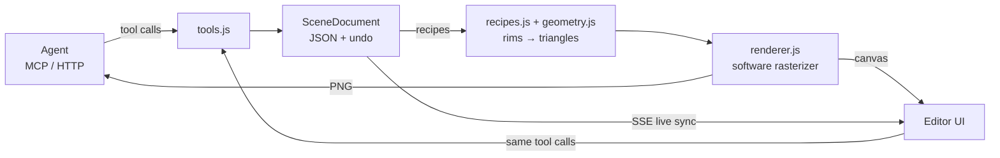

# How cpu3d works

cpu3d does in JavaScript what a GPU does in hardware. This document walks through the pieces, from JSON recipe to pixel.



## 1. Geometry from rims

The core idea comes from the old Babylon.js GeometryBuilder: a surface is a list of **rims** (rings of points). `fromRims` stitches rim *i* to rim *i + 1*, and each quad between them becomes two triangles:

```
rim i+1:  c ─── d
          │ ╲   │      triangles (a, c, b) and (b, c, d)
rim i:    a ─── b
```

Most shapes are just different rim generators:

| Shape | Where the rims come from |
|---|---|
| lathe | every profile point `[r, y]` becomes a circle of radius r at height y |
| sphere, cylinder, cone | special cases of lathe (half circle, two rims) |
| sweep | a 2D cross-section placed at every point of a 3D path |
| tube, torus | sweep of a circle along a path / along a circle |
| parametric | `f(u, v)`: u picks the rim, v the point on it |

**Sweep frames.** To orient the cross-section along a path, each path point needs a local frame: the tangent **T** plus two perpendicular axes **N** and **B**. Frenet frames (derived from curvature) flip at inflection points and the tube twists. cpu3d uses **parallel transport** instead: the previous N is reused with its component along the new tangent removed, `N' = normalize(N − T(N·T))`, `B = T × N`. On closed paths the leftover rotation after one loop is measured and spread evenly over all frames, so there is no seam.

**Extrude caps** are triangulated with **ear clipping**: find a convex corner whose triangle contains no other vertex, cut it off, repeat. O(n²), fine for hand-made shapes, and it handles concave polygons.

**Normals** are area-weighted: each triangle adds its cross product `(b − a) × (c − a)` to its three vertices, then they are normalized. **Orientation** is checked with the signed volume `Σ a · (b × c) / 6`; if it is negative the triangles face inwards and `orientOutward()` flips them. The test suite checks volumes against analytic values (sphere ≈ 4/3 π r³, etc.).

## 2. Recipes and the document

Agents never send code. They send recipes, plain JSON such as `{ "type": "lathe", "profile": [...] }`, which `recipes.js` validates field by field and turns into geometry. Geometry is cached by the recipe's JSON, so 36 identical torus knots share one geometry.

Animation is data too: an object can carry behaviours such as `{ "spin": { "speed": 90 } }`. Each frame, `updateAnimation` recomputes only the affected object matrices and emissive values from the time `t`. Geometry, caches and the G-buffer layout stay untouched, and the scene version is bumped so the shadow map is rebuilt for the new pose. Keyframes are sampled per channel (smoothstep, linear, step, or a cubic Hermite spline with Catmull-Rom tangents for uneven key spacing), and the camera path is sampled the same way.

GIF export renders each frame several times at times spread over the shutter interval and averages them, which gives anti-aliasing, soft shadows and motion blur from the same accumulation buffer. The encoder builds one median-cut palette from a few frames of the clip (stable colors, no flicker), applies a 4x4 ordered dither, writes unchanged pixels as transparent and crops each frame to the changed rectangle before LZW compression.

The `SceneDocument` is the single source of truth. Every mutation runs on a copy, is validated, then committed with an undo snapshot and broadcast to listeners (SSE clients, autosave, the activity feed).

## 3. Vertex stage

**Mesh culling.** Each geometry has a bounding sphere. The six frustum planes are extracted from the view-projection matrix (Gribb/Hartmann). A mesh whose sphere lies completely behind one plane is skipped.

**Transform.** Every vertex is multiplied by the model-view-projection matrix into **homogeneous clip coordinates** `(x, y, z, w)`, where w is roughly the distance to the camera. Dividing by w produces perspective. Screen coordinates are rounded to a **1/16 sub-pixel grid** and stored as integers, so the rasterizer works with exact numbers.

**Wind.** Objects with the `wind` behaviour are deformed here, in world space, before the projection: each vertex is pushed along the wind direction by `strength · h²` (h = height above the object's base, so roots stay put and tips swing), scaled by a travelling wave `sin((t · speed − x_along) · 2π / wavelength)` plus a faster harmonic, and lowered a little so the blade bends instead of stretching. Because the wave depends on the world position, neighbouring blades of one `scatter` move together like gusts over a field. The shadow map applies the same displacement.

**Lighting (Gouraud).** Light is computed per vertex and interpolated across the triangle:

- hemisphere ambient: blend between ground and sky color by how much the normal points up
- Lambert diffuse: `max(0, N · L)`
- Blinn-Phong highlight: `(N · H)^shininess` with the half vector `H = normalize(L + V)`
- linear fog by distance

**Atmosphere.** With `set_environment({ atmosphere })` every pixel (background included) gets an extra pass after shading: the color is blended towards the medium color by `1 − e^(−density · distance)`, and a ray per 2x2 block of pixels is marched through the medium (10 steps, 6 while moving, packed towards the eye), keeping the running sum of scattered light that each pixel reads at its own depth. At each step a moving noise field across the light direction says how much light is scattered towards the eye there (thresholded, so beams are separated by dark gaps), attenuated by the medium in front and blocked when the shadow map says the point is in shadow. The step offset is interleaved gradient noise that shifts every frame, so temporal AA averages the march; the pass runs per row on the worker pool like the shading.

## 4. Primitive stage

**Outcodes.** Each vertex gets 6 bits, one per clip plane. `a & b & c ≠ 0` means all three vertices are outside the same plane, so the triangle is rejected immediately. `a | b | c = 0` means fully inside: fast path.

**Guard band.** Triangles are clipped sideways only at 8× the screen size; the rasterizer's bounding box takes care of everything in between. In practice almost only triangles crossing the near plane need real clipping (3 of 23,000 in the showcase).

**Sutherland-Hodgman clipping** runs in homogeneous space, before the division by w, which matters for points behind the camera. The polygon is clipped against each crossed plane, intersections interpolate position and color, and the result (up to 9 vertices) is drawn as a triangle fan.

**Back-face culling** uses the signed area `(x1 − x0)(y2 − y0) − (x2 − x0)(y1 − y0)`. Because screen y points down, front faces have a negative area here.

## 5. Rasterization

**Edge functions.** For each edge a → b:

```
E(p) = (bx − ax)(py − ay) − (by − ay)(px − ax)
```

A pixel center is inside when all three edge functions are ≥ 0. E is linear, so stepping one pixel to the right is a single addition.

**Top-left fill rule.** A pixel center exactly on an edge shared by two triangles must be drawn by exactly one of them, otherwise you get cracks or double-drawn pixels. Like Direct3D and OpenGL, cpu3d only accepts such pixels on top or left edges; other edges get a bias of −1. Because everything is integer math on the sub-pixel grid, this is exact.

**Spans instead of pixel tests.** Instead of testing every pixel in the bounding box, each row's covered span is solved directly:

```
E(x) = A·x + e_row ≥ 0   →   x ≥ ⌈−e/A⌉   (A > 0)
                             x ≤ ⌊e/−A⌋   (A < 0)
```

Intersecting the three conditions gives `[xs, xe]`, and the inner loop only does the depth test and the write. The divisions are exact because all values are integers far below 2⁵³. The test suite compares 1,500 random triangles against a brute-force reference, pixel for pixel.

**Interpolation.** Depth and color are planes over the screen: `value(px, py) = base + dx·px + dy·py`. The gradients are solved once per triangle (Cramer's rule), after that each attribute costs one addition per pixel.

**Depth buffer with 1/w.** cpu3d stores `1/w` (larger = closer). 1/w is exactly linear in screen space, so interpolating it is correct, and near objects get the most precision.

**Wireframe.** Dividing E by the length of its gradient gives the pixel's distance to the edge, so edges are drawn inside the same loop, with hidden-line removal for free.

## 6. The high quality path

The default `quality: 'high'` turns the renderer into a small deferred renderer:

1. **G-buffer.** The rasterizer writes per pixel: depth (1/w), a perspective-correct normal (attributes interpolated as `n/w` and divided by the interpolated `1/w`), the sRGB albedo and a material index. No lighting yet, so hidden pixels cost almost nothing.
2. **Shadow map.** The scene is rasterized once more from the light with an orthographic projection fitted to the area around the camera target, using a depth-only version of the same edge-function rasterizer. It is cached until the scene, the light or the framing changes, so orbiting the camera does not redraw it.
3. **Ambient occlusion (SSAO).** For one pixel per 2×2 block, 8 points in a disc around the pixel (radius in world units, projected to pixels) are read back from the depth buffer and turned into view-space positions. Points that lie above the surface (along the normal) and within the radius occlude. The sample disc is rotated in a 4×4 pattern and per frame, then a 4×4 box blur that skips pixels at a different depth removes the pattern without bleeding across silhouettes.
4. **Shading.** For every covered pixel the world position is reconstructed from depth and the camera basis, then: hemisphere ambient × AO + sun × (Lambert + Blinn-Phong highlight) × shadow visibility + extra lights + environment reflection + emission. The highlight `pow(n·h, shininess)` is computed as `(1 + shininess·(n·h − 1)/16)^16`: four multiplies, close to `exp`, and exactly zero in the tail, so glossy surfaces get no haze. The shadow test uses a normal offset against acne and bilinear PCF; the PCF point wanders over a disc that grows with the light's `softness`.
5. **Materials.** Metals (`metalness`) reflect in their own color and have no diffuse term. Reflections use the view vector mirrored at the normal, looked up in an analytic environment: the sky gradient, or a studio made of softbox rectangles whose edges get softer with `roughness`, so blurry reflections need no prefiltered maps. The amount follows the split-sum environment BRDF (Karis/Lazarov analytic fit), which keeps rough surfaces from shining at grazing angles. Matte dielectrics skip the lookup entirely.
6. **Textures.** A textured mesh gets UVs from a planar projection along its thinnest local axis, interpolated perspective-correct as `u/w`, `v/w`, and the rasterizer samples the texture bilinearly straight into the G-buffer albedo. Emissive surfaces use the inverse of the tone curve, so a screen texture with `emissive: 1` appears with exactly its authored colors.
7. **Color.** Albedo is decoded from sRGB to linear, light is added in linear space, and an **ACES filmic** curve plus sRGB encoding (one 65,536-entry lookup table) bring it back to the display range. Fog is mixed afterwards in display space so it matches the background exactly.
8. **Progressive refinement.** When the view does not change, every new frame shifts the projection by a sub-pixel Halton offset, rotates the AO kernel, moves the PCF sample point and jitters rough reflection directions. The frames are averaged in an accumulation buffer: anti-aliased edges, soft shadow borders and smooth AO appear within a few frames.

## 6b. Threads, temporal anti-aliasing and caches

The main thread only prepares a frame: culling, materials, motion and a **draw list** (one entry per visible mesh, its matrices in a shared buffer). Everything else runs on a pool of render threads (`pool.js`, `render-worker.js`, Web Workers in the browser, worker_threads in Node) over `SharedArrayBuffer`s. A frame is one message per thread; inside it the threads meet at barriers in shared memory (`Atomics.wait`) instead of talking to the main thread between stages:

| Stage | Unit of work | Notes |
| --- | --- | --- |
| vertex + shadow part 1 | 4,096 vertices of a draw; 32 rows of a shadow map to clear or copy; 8,192 caster vertices | every draw's vertices land at its offset in frame-wide buffers |
| binning + shadow part 2 | 2,048 triangles; 32 rows of a shadow map | each triangle is tested once and appended to the lists of the band groups whose rows it covers (sort-middle); casters are rasterized into their rows |
| raster | a band group (interleaved 8-row bands, 3 groups per thread) | a group's lists are drawn in draw order, so every pixel sees the triangles in the same order as on one thread |
| AO, lighting + atmosphere, TAA or accumulation | 2 AO block rows (4 pixel rows) | barrier after AO (the blur needs its neighbours) and after lighting (TAA needs the 3x3 neighbourhood) |

Units are **claimed** from atomic counters, not dealt out: a thread that got cheap sky simply takes the next unit, so no thread waits long at a barrier (the pool's `profile` reports, per stage, the slowest thread and the average). Shadow maps use "greater wins" depth, so it does not matter which thread draws which caster. The result is pixel-identical to one thread, which the tests check for static, animated and wind scenes, the fast path and wireframes. Frames from several renderers queue up on one pool; geometry and textures are copied to shared memory once and released when no frame used them for a while. If a thread fails or dies, the others are released from their barriers (abort flag), the error reaches the renderer, and it renders that frame and the following ones on its own thread.

Temporal anti-aliasing reconstructs each pixel's world position from the depth buffer, projects it with the previous and the current unjittered view-projection and samples the history at the pixel center plus that motion. Using the motion instead of the jittered position keeps a still image from blurring. The history is sampled with a Catmull-Rom filter, clipped towards the mean of the current 3x3 neighbourhood in YCoCg until it lies within ± 1.25 standard deviations (keeps the hue, no coloured fringes). Each history pixel also remembers which mesh it showed; if none of the 3x3 history pixels around the reprojected spot showed the current mesh, the surface was just uncovered and the pixel starts over (no ghost trails). Animated meshes carry their own motion (previous model matrix times the inverse of the current one), and blended with 25% of the new frame, more when the pixel moves fast. When the camera stops, the progressive average is seeded with the history, weighted by the number of frames it represents.

Soft shadows sample one point of the penumbra per pixel and frame. While things move, that point is random per pixel (fine noise that TAA averages); for the still refinement it follows a Halton sequence. Shadow map origins are snapped to whole texels and the map size changes only with hysteresis, so shadows neither swim nor pop when the camera moves. With fairly hard light a second, finer map covers what the camera looks at. The shadow maps are cached on the scene: static casters are drawn once into a base map; meshes marked `dynamic` (animated or being dragged) are drawn per frame onto a copy of it, by the render threads.

## 7. Why it is fast

| Technique | Effect |
|---|---|
| typed arrays everywhere | compact memory, V8 compiles the hot loops to near machine code |
| no allocations in hot loops | no garbage collection pauses |
| one 32-bit store per pixel | `0xff000000 \| b<<16 \| g<<8 \| r` writes all four channels at once |
| screen coordinates cached per vertex | a vertex shared by six triangles is transformed once |
| cull early and cheaply | mesh sphere → outcodes → signed area → bounding box |
| clipping only when needed | the guard band keeps it below 1 % of triangles |
| spans solved analytically | no work for pixels outside the triangle |
| render on demand in the editor | nothing is drawn when nothing changed |

The result is about 12 million triangles and up to 280 million pixels per second on one core.

## 8. Agents in the loop

`render_view` uses the same renderer headlessly: it renders into a `Uint8ClampedArray`, encodes a PNG with `zlib` (no dependencies) and returns it as MCP image content. The agent sees what it built, and with `probe_height` (vertical raycasts with Möller-Trumbore) it can place objects on terrain or on top of each other instead of guessing coordinates.
